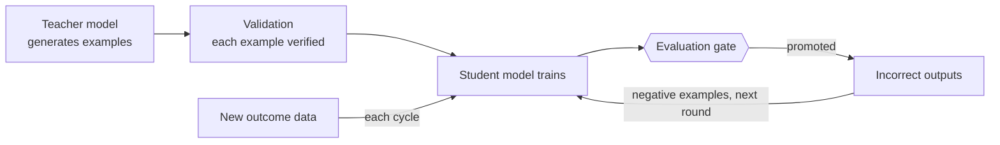
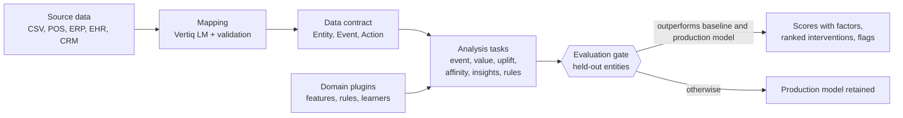

<p align="center"></p>

<p align="center"><b>Self-improving decision intelligence: a local language model and outcome-trained decision models,<br>improved recursively under an evaluation gate.</b></p>

<p align="center">
<a href="https://github.com/BiswajitBiswa/vertiq/actions/workflows/tests.yml"></a>
<a href="LICENSE"></a>


</p>

<p align="center"><a href="https://biswajitbiswa.github.io/vertiq/">Documentation</a> · <a href="https://biswajitbiswa.github.io/vertiq/benchmarks.html">Benchmarks</a> · <a href="https://biswajitbiswa.github.io/vertiq/guides/">Industry guides</a> · <a href="lm/README.md">Vertiq LM</a></p>

## Overview

Vertiq is an open-source, self-improving decision intelligence system with three components:

- **Vertiq LM**, a 4-billion-parameter language model fine-tuned locally to map any source table to a common data contract.
- **The decision engine**, which predicts customer, asset and account outcomes, estimates the effect of interventions against control
  groups, and reports tested patterns and rule violations. It is a dependency-free Python package that runs inside the host application.
- **Recursive self-improvement (RSI)**: each generation of a model trains its successor, and a generation is promoted only after it
  outperforms the one in production on held-out data.

## Recursive self-improvement (RSI)



Vertiq improves its models through recursive self-improvement (RSI) under evaluation control. In each round a teacher model generates additional training examples, and every example is validated against its own data before it is used. The student model is trained and evaluated on held-out records; it is promoted only if it outperforms the production model, and the promoted model becomes the starting point for the next round. Its incorrect outputs are retained as negative examples for the following round, and new outcome data is added at every cycle. No iteration reaches production without passing the evaluation gate.

For Vertiq LM, the teacher is a larger open-weight model or an OpenAI-compatible endpoint configured by the user. A generated table is
retained only if it loads with its own mapping and the teacher reproduces the mapping without seeing it. Incorrect student outputs are
used as negative examples in preference training (ORPO). Providers whose terms prohibit training on generated output (OpenAI, Anthropic,
Google) are excluded. Applied to table mapping, this process raised exact-match accuracy of a 4-billion-parameter model from
3.5% to 35.1% on the same held-out set.

## Role alongside large language models

Vertiq is a specialised model system, not a general-purpose assistant. Where foundation models generate text, Vertiq makes and verifies operational decisions: its local model maps source data to a common contract, deterministic validation checks the mapping, and each new generation of its decision models is promoted only when it measurably outperforms the generation in production.

| Property | Detail |
|---|---|
| No dependency footprint | The decision engine uses only the Python standard library, so it can be vendored into an existing service, run on a server or embedded in an edge device without adding packages to the environment. |
| Local schema mapping | Vertiq LM runs on Apple Silicon and maps source tables without sending data to an external API. Its output is validated against the rows before it is used. |
| Promotion control | The evaluation gate compares every candidate with a rule-based baseline and the production model on held-out entities, with an optional minimum margin (min_gain). |
| Measured outcomes | Uplift is estimated against randomised control groups, so reported effects reflect the intervention rather than pre-existing behaviour. |

## Challenges addressed

| Challenge | Approach |
|---|---|
| Schema onboarding | Vertiq LM proposes a column mapping from the header and sample rows. Column names, value types and the date format are then validated against the data before use. |
| Attribution bias | Uplift models are trained against randomised hold-out groups and rank entities by the expected change an intervention produces. |
| Unvalidated retraining | Each candidate is evaluated on held-out entities against a rule-based baseline and the production model, and is promoted only if it performs better. |
| False discoveries | Candidate insights are reported only after Benjamini–Hochberg false-discovery-rate control. |
| Domain knowledge | Feature and rule plugins encode that knowledge without modifying the decision engine. The evaluation gate measures their contribution. |
| Data residency | The decision engine has no third-party dependencies and makes no network calls. Vertiq LM runs locally on Apple Silicon. |

## Capabilities

| Capability | API | Description |
|---|---|---|
| Event prediction | `tasks.predict_event` | Probability that an event occurs for an entity within a time window, such as customer return, equipment failure, readmission or late payment. |
| Value prediction | `tasks.predict_value` | Expected value of the next event, such as order value, repair cost, length of stay or renewal amount. |
| Intervention effects | `tasks.predict_uplift` | Effect of any recorded action, such as a maintenance programme, outreach call or carrier change, estimated against a control group, with the entities it helps most. |
| Effects without a control group | `causal.matched_att` | Matched-cohort estimates when an intervention was not randomised, with balance diagnostics and an interval. |
| Time to next event | `survival` | Probability of the next event within a window given the time elapsed, personalised to each entity's rhythm. |
| Affinity and sequences | `affinity · sequences` | Co-purchase associations, the next likely product, replenishment intervals and tested A-then-B patterns with their typical lag. |
| Tested insights | `insights` | Segment-level patterns reported only after false-discovery-rate control. |
| Monitoring | `drift · sequential` | Input and score drift, accuracy on new outcomes, and sequential tests that can be checked continuously. |
| Rule-based checks | `rules` | Repeat events, overdue tasks, consumption above specification and incomplete records. |
| Plain-language descriptions | `narrate` | Predictions, gate decisions and effect estimates written as sentences; an optional local model rewrites them, and a rewrite with any number not in the result is rejected. |

All analyses operate on one data contract of entities, events and actions. Vertiq contains no industry-specific code; the
[industry guides](https://biswajitbiswa.github.io/vertiq/guides/) document the mapping and analyses for each industry.

## Design principles

### Structural intelligence

Language-model output is constrained by verification against the data.

- **Local schema resolution.** Vertiq LM, a 4-billion-parameter model fine-tuned with LoRA, proposes a mapping from the column headers and sample rows. It runs on the user's machine; source data is not sent to an external service.
- **Deterministic validation.** vertiq.mapping.repair checks the proposal against the rows: names are matched to existing columns, roles are checked against value types and the date format is inferred. It never introduces a column that does not exist.
- **Bounded data contract.** Every record is expressed as an entity, a timestamp, an event type, a value and attributes. Rows that fail validation are reported to the caller, so models train only on records that loaded.

### Causal measurement

Intervention effects are estimated against control groups rather than inferred from correlation.

- **Control-group uplift.** vertiq.uplift compares treated entities with a randomly held-out group over the same window and ranks entities by estimated incremental effect. In the benchmark it estimated a planted −20% offer effect at -20.2%.
- **Configurable horizons.** window_days sets the prediction horizon, cutoffs the number of historical training points and history the event types used as inputs, so each task matches the operating cycle of the industry.
- **Small footprint.** The decision engine has no third-party dependencies and no network layer. It runs wherever Python 3.10 runs; the full benchmark suite completes in 48 seconds on a laptop using 8 cores.

### Defensive deployment

A candidate model is treated as unproven until it has been evaluated.

- **Held-out evaluation.** Candidates are scored on entities excluded from training, using features built only from events recorded before each cutoff.
- **Champion–challenger gate.** A candidate must outperform the rule-based baseline and the production model, and its gain over the baseline must be clear at 90% confidence by default. min_gain sets a required margin: an AUC margin for event tasks and a relative error reduction for value tasks.
- **Explicit rejection.** A rejected candidate returns status "kept" with the reason, such as the AUC it reached against the required threshold. The production model remains in service.

| Principle | Mechanism | Configuration | Operational value |
|---|---|---|---|
| Structural intelligence | Local mapping proposal, validated against the rows | Fine-tune Vertiq LM on your naming conventions (lm/); vertiq.mapping.repair | Source data stays on premises; new sources are onboarded without hand-written mappings |
| Causal measurement | Control-group uplift and point-in-time tasks | window_days, cutoffs and history in vertiq.tasks; a hold-out share on every campaign | Intervention effects are measured rather than assumed; horizons match each industry's cycle |
| Defensive deployment | Entity-level holdout with champion–challenger comparison | min_gain in vertiq.tasks and vertiq.harness | Weaker or unstable candidates are not promoted; the production model stays in service |

## Architecture



1. **Mapping.** The host application maps its records once. Vertiq LM proposes the mapping, and `vertiq.mapping.repair` validates
   column names, value types and the date format against the rows. It never introduces a column that does not exist.
2. **Training.** Tasks build examples at successive historical cutoffs, using only information available at each cutoff.
3. **Evaluation.** Approximately 20% of entities, selected by a hash of their identifier, are excluded from training. A candidate is
   promoted only if it outperforms the rule-based baseline and the production model on those entities (`vertiq.harness`).
4. **Explanation.** Each score lists the factors that raised and lowered it; each rule flag includes its supporting evidence.

## Requirements

| Component | Requirement |
|---|---|
| Decision engine (`vertiq`) | Python 3.10, 3.11 or 3.12; no third-party dependencies; any operating system |
| Vertiq LM tooling | Apple Silicon, 16 GB of memory or more, `mlx-lm` and `mlx-lm-lora` (installed with the `lm` extra) |

## Installation

```bash
pip install git+https://github.com/BiswajitBiswa/vertiq
pip install "vertiq[lm] @ git+https://github.com/BiswajitBiswa/vertiq"      # Vertiq LM tooling
```

## Quick start

```python
import csv
from vertiq.mapping import Mapping, apply, repair
from vertiq.tasks import predict_event

rows = list(csv.DictReader(open("work_orders.csv")))
m, notes = repair(Mapping.parse({"entity": "Equipment No", "time": "Work Order Date", "type": "Order Type",
                                 "value": "Cost", "group": "Plant", "attrs": [], "date_format": "%Y-%m-%d"}), rows)
ds, problems = apply(m, rows)            # rows that fail to load are reported, not imputed

task = predict_event(ds, target="breakdown", window_days=30)
print(task.status)                        # trained, kept (baseline retained) or learning (insufficient data)
print(task.report()["metrics"])           # AUC, Brier score, calibration, baseline AUC, held-out entities
print(task.score("EQ-602"))               # {"chance": ..., "raises": [...], "lowers": [...]}

from vertiq import narrate
print(narrate.gate(task.report()))        # "A model to predict whether breakdown happens within 30 days was promoted. ..."
print(narrate.prediction(task.score("EQ-602"), target="breakdown", window_days=30))
```

## Extending Vertiq

```python
from datetime import timedelta
from vertiq import plugins
from vertiq.tasks import predict_event

@plugins.feature("plants")
def skipped_maintenance(entity, before, cut):
    # `before` contains only events recorded before the training cutoff
    return {"skipped_pm_60": sum(1 for e in before
                                 if e.type == "pm" and e.attrs.get("PM Done") == "no"
                                 and e.at >= cut - timedelta(days=60))}

task = predict_event(ds, target="breakdown", window_days=30, pack="plants")
```

| Extension point | Interface |
|---|---|
| `@plugins.feature(pack)` | `fn(entity, events_before, cutoff) -> {name: number}`; receives only events recorded before the cutoff |
| `@plugins.rule(pack)`, `vertiq.rules` | `repeat`, `overdue`, `exceeds` and `too_short`, configured with parameters |
| `plugins.register_learner(name, cls)` | Required: `fit(rows, y, **kw) -> self`, `predict(row, group=None)`, `to_dict()`, `from_dict(d)`. Optional: `fit_offsets`, `contributions`. Built in: `logistic`, `linear`, `boosted`, `boosted_regression`, and `auto`, which chooses on training entities only |
| `verticals.register(Vertical(...))` | Time windows, terminology and currency for an industry |
| Vertiq LM teachers | `TEACHER_API_KEY`, `TEACHER_BASE_URL` and `TEACHER_MODEL` for any OpenAI-compatible server |

Plugins add features; the evaluation gate determines whether they improve performance on held-out entities.

## Design guarantees

- **No look-ahead.** Features, including plugin features, use only events recorded before each cutoff.
- **Entity-level holdout.** No entity appears in both training and evaluation data.
- **No unvalidated promotion.** A candidate replaces the production model only if it performs at least as well on the same held-out entities, or by the margin set with `min_gain`.
- **No imputed structure.** Mapping validation selects existing columns or removes the role; rows that fail to load are reported.
- **No network or file access.** The package opens no connections or files. `tests/test_boundary.py` rejects framework, ORM and HTTP imports.
- **Reproducibility.** Benchmarks, the documentation site and this README are generated from committed results; CI fails if they diverge.

## Benchmarks

Synthetic scenarios with known ground truth, 5 runs each, mean ± standard deviation (`python benchmarks/run.py`,
48 seconds on a laptop using 8 cores, arm64, Python 3.10.10).

| Scenario | Vertiq | Reference |
|---|---|---|
| Customer retention | AUC 0.976 ± 0.005, Brier 0.043 ± 0.004 | Recency rule: AUC 0.969 ± 0.005, Brier 0.061 ± 0.006 |
| Equipment failure | AUC 0.735 ± 0.059; with one plugin 0.767 ± 0.043 | Recency rule: AUC 0.674 ± 0.050 |
| Length of stay | MAE 1.61 ± 0.06 days | Previous value: 2.18 ± 0.14 days |
| Random data | Models promoted: 2 of 25 (default gate), 11 of 25 (confidence check off) | Worse than the baseline: must be 0 |
| Intervention uplift | Top half 23.6 ± 5.9 pts; bottom half -1.8 ± 5.2 pts | True effect: +30 pts for overdue customers only |
| Offer effect on order value | -20.2 ± 0.9% | True effect: −20% |
| Insight detection | Planted pattern detected 5/5; false patterns 0 | Benjamini–Hochberg at 10% |
| Non-linear effects (U-shaped) | boosted AUC 0.690 ± 0.022 | linear AUC 0.670 ± 0.024 |
| Time to next event | AUC 0.954 ± 0.013 with the survival feature | without: 0.947 ± 0.014 |
| Effect of any action | old -0.266 ± 0.035, new -0.018 ± 0.021 | true: −0.25 and 0 |
| Effect without a control group | matched 1.017 ± 0.019 | true 1.0; naive 3.076 ± 0.131 |
| Sequential test | false alarms 0.041 ± 0.014, detection 0.799 ± 0.017, 147 observations | targets 0.05 and 0.80; fixed sample 253 |
| Drift | PSI 0.931 ± 0.037 when shifted | 0.011 ± 0.004 when stable |
| Lagged sequences | planted found 5/5, lag 20 days | true lag 18 to 22 days |
| Mapping validation | Correct mappings altered: 0 of 2100 per run | Must be 0 |

### Real data: Online Retail II

Repeat purchase within 60 days for 5,881 customers (36,975 orders, UCI Online Retail II,
CC BY 4.0), 20% of customers held out (`python benchmarks/public/online_retail.py --data online_retail_II.xlsx`).
Recency baseline AUC 0.761.

| Learner | AUC | 90% interval | Gain over baseline (90%) |
|---|---|---|---|
| Linear (logistic) | 0.807 | 0.790–0.824 | +0.036 to +0.053 |
| Linear with the survival feature | 0.807 | 0.790–0.824 | +0.037 to +0.054 |
| Boosted trees | 0.812 | 0.795–0.827 | +0.043 to +0.059 |
| Auto (chose boosted) | 0.812 | 0.795–0.827 | +0.043 to +0.059 |
| scikit-learn logistic regression (reference) | 0.807 |  |  |

### Vertiq LM table mapping

Qwen 3.5 4B (Apache 2.0, 4-bit MLX), fine-tuned with LoRA on an Apple M1 Pro with 16 GB of memory. 114 held-out tables across 15
domains; 4 domains (energy, insurance, manufacturing, retail sales) are excluded from training. "Validated" means after
`vertiq.mapping.repair`.

Original test set:

| Model | Loads | Exact | Exact, validated | Unseen domains, exact |
|---|---|---|---|---|
| Qwen 3.5 4B, no training | 57.9% | 3.5% | 8.8% | 4.2% |
| + LoRA fine-tune (round 1) | 66.7% | 20.2% | 30.7% | 12.5% |
| + ORPO on its own mistakes | 78.1% | 28.1% | 38.6% | 22.9% |
| Round 3 fine-tune | 93.9% | 35.1% | 39.5% | 29.2% |

Production-like test set (audit columns and locale-specific number formats):

| Model | Loads | Exact | Exact, validated | Unseen domains, exact |
|---|---|---|---|---|
| + ORPO on its own mistakes (round 1 model) | 80.7% | 29.8% | 34.2% | 14.6% |
| Round 3 fine-tune | 91.2% | 41.2% | 43.9% | 31.2% |

## Verify the results

Every decision-engine figure can be reproduced from a clean checkout with Python and pytest; the benchmark suite runs in about 48 seconds on a laptop using 8 cores. Vertiq LM figures require Apple Silicon and the model weights; see [lm/README.md](lm/README.md).

```bash
git clone https://github.com/BiswajitBiswa/vertiq && cd vertiq
python -m pip install pytest && python -m pytest -q     # unit tests and every industry guide's reference implementation
python benchmarks/run.py --seeds 5                      # regenerates benchmarks/results/core.json
python docs/build.py && git diff --stat                 # regenerates the site and this README; no diff means the figures match
```

## Methods

The methods are established and deliberately transparent: regularised logistic and linear regression with per-group offsets, a single-model (S-learner) uplift formulation with treatment interaction terms, Benjamini–Hochberg false-discovery control and rule-based checks. Vertiq's contribution is the structure around them: point-in-time features, entity-level holdout, control-group measurement, the promotion gate and local mapping. Stronger estimators can be registered through register_learner and are evaluated by the same gate.

## Positioning

- **Modelling libraries.** scikit-learn, LightGBM and XGBoost provide general estimators. Vertiq provides the task structure,
  point-in-time features and evaluation gate, and can run any of those estimators through `register_learner`.
- **Model registries.** MLflow and similar tools track and serve models. Vertiq decides whether a retrained model qualifies for
  promotion; the two are complementary.
- **Schema extraction.** General extraction libraries constrain a language model to a schema. Vertiq LM is trained for one task,
  mapping a table to a data contract, and each result is validated against the table's rows.

## Limitations

- Most benchmarks use synthetic data. They verify that the methods detect planted signal, reject noise and retain the baseline
  when appropriate; one public dataset (Online Retail II) has been run. None measures accuracy on a specific organisation's data.
- The gate requires the gain over the baseline to be clear at 90% confidence (`confidence=0.9`, the default). On small datasets this
  also holds back some real improvements until more data arrives: with 240 assets and a real signal, 7 of 15 candidates were
  promoted, against 13 of 15 with the check off. `confidence=None` turns the check off; the candidate then only has to not be worse.
- Plain-language descriptions (`narrate`) are written from templates. A local model can rewrite them; a rewrite is kept only if
  every number in it appears in the result, which catches invented figures but not every misleading sentence.
- After validation, Vertiq LM maps 44% of unseen tables exactly and loads 99%
  without errors. Proposed mappings should be reviewed before production use.
- Uplift estimation requires a randomised control group. Without one, `causal.matched_att` gives an estimate whose validity
  depends on every confounder being observed; `design.next_step` reports the experiment size needed to settle the question.
- On the synthetic benchmarks, boosted trees improve on linear models where effects are non-linear and do not where effects are
  additive. Across 100 to 6,400 entities the default tree settings were within 0.01 AUC of the best of five alternatives.
  `learner="auto"` chooses by 3-fold cross-validation on the training entities; with a few hundred entities or fewer its
  choice is close to random when the two learners are within a point or two of each other.
- Version 0.1. The API may change before 1.0; changes are recorded in [CHANGELOG.md](CHANGELOG.md).

## Roadmap

- Further public benchmarks: M5 (value prediction), NASA C-MAPSS (equipment failure),
  KKBOX (churn), and Hillstrom and Criteo (randomised uplift); protocols in [proposal 0001](proposals/0001-statistical-validation.md), part C.
- Distribution on PyPI.
- Vertiq LM: complete preference training on the production-like set, evaluate a 9B student and publish the adapter.
- A two-sample sequential test (mixture SPRT) for comparing two live arms, and doubly robust effect estimation.
- An evaluation loop that proposes plugin features and learner settings automatically and keeps only those that pass the gate on
  training entities, with the held-out entities reserved for the final score.

Further reading on recursive self-improvement is kept in [proposals/reading-list.md](proposals/reading-list.md), and an external assessment of the competitive landscape in [proposals/landscape-review.md](proposals/landscape-review.md).

## Industry guides

- [Retail and consumer goods](https://biswajitbiswa.github.io/vertiq/guides/retail-consumer-goods.html): Predict repeat purchase, recommend the next product from basket history, and plan replenishment from sales velocity.
- [Travel and hospitality](https://biswajitbiswa.github.io/vertiq/guides/travel-hospitality.html): Forecast repeat stays, estimate the value of the next booking, and measure campaign response against control groups.
- [Banking and financial services](https://biswajitbiswa.github.io/vertiq/guides/financial-services.html): Identify dormant and declining accounts from transaction activity and prioritise relationship outreach. Vertiq models client behaviour, not market prices.
- [Insurance](https://biswajitbiswa.github.io/vertiq/guides/insurance.html): Predict claims and policy lapses, estimate claim severity, and flag repeat claims for review.
- [Healthcare and life sciences](https://biswajitbiswa.github.io/vertiq/guides/healthcare-life-sciences.html): Predict readmissions, estimate length of stay, and monitor follow-up compliance.
- [Manufacturing and industrial assets](https://biswajitbiswa.github.io/vertiq/guides/manufacturing-industrial.html): Predict equipment failures, estimate repair costs, and detect skipped maintenance and parts consumption above specification.
- [Supply chain and logistics](https://biswajitbiswa.github.io/vertiq/guides/supply-chain-logistics.html): Forecast item demand, plan reorder points, and identify slow-moving inventory from stock movements.
- [Telecommunications](https://biswajitbiswa.github.io/vertiq/guides/telecommunications.html): Predict subscriber churn and recharge behaviour, and estimate next-period usage.
- [Energy and utilities](https://biswajitbiswa.github.io/vertiq/guides/energy-utilities.html): Predict outages by meter or asset, and estimate next-period consumption.
- [Software and subscriptions](https://biswajitbiswa.github.io/vertiq/guides/software-subscriptions.html): Predict cancellations and downgrades, and estimate renewal value from product usage and billing events.
- [Wholesale and distribution](https://biswajitbiswa.github.io/vertiq/guides/wholesale-distribution.html): Identify accounts with declining orders, predict late payments, and recommend the next SKU per account.
- [Accounting and tax compliance](https://biswajitbiswa.github.io/vertiq/guides/accounting-tax.html): Predict late filings, track overdue returns, and identify recurring notices by client.
- [Education and public services](https://biswajitbiswa.github.io/vertiq/guides/education-public-services.html): Identify early disengagement from attendance and assessment records so that support can be offered in time.

## Repository structure

| Path | Contents |
|---|---|
| `vertiq/` | Decision engine: contract, mapping, tasks, harness, plugins, rules, churn, uplift, value, affinity, insights, inventory, offers |
| `tests/` | Unit tests, the dependency boundary test and every industry guide's reference implementation |
| `benchmarks/` | `run.py`, `collect_lm.py` and `results/*.json` |
| `lm/` | Vertiq LM: data generation, LoRA fine-tuning, evaluation, preference training and the teacher pipeline |
| `docs/` | Documentation site and `build.py`, which also generates this README |

## Contributing

See [CONTRIBUTING.md](CONTRIBUTING.md). Report security issues as described in [SECURITY.md](SECURITY.md). Citation metadata is in
[CITATION.cff](CITATION.cff).

## Licence

Apache License 2.0; see [LICENSE](LICENSE). The Qwen 3.5 weights used by Vertiq LM are not distributed in this repository and are
licensed separately under Apache 2.0.
