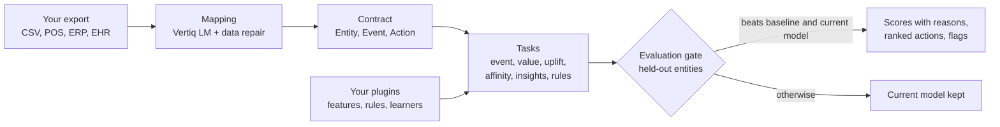
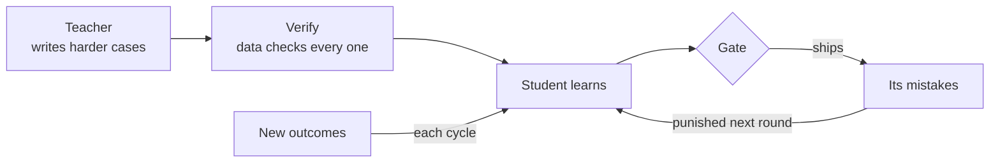

<p align="center"></p>

<p align="center"><b>Decisions you can trust, learned from your own outcomes.</b></p>

<p align="center">
<a href="https://github.com/ideatorlabs/vertiq/actions/workflows/tests.yml"></a>
<a href="LICENSE"></a>


</p>

<p align="center"><a href="https://ideatorlabs.github.io/vertiq/">Docs</a> · <a href="https://ideatorlabs.github.io/vertiq/benchmarks.html">Benchmarks</a> · <a href="https://ideatorlabs.github.io/vertiq/guides/">Sector guides</a> · <a href="lm/README.md">Vertiq LM</a></p>

Vertiq is a Python library for business decision models. It predicts what happens next to a customer, a machine, a patient or an
account; it measures which actions actually changed the outcome, using control groups; and it replaces a model only when the new
one beats both a simple baseline and the current model on records it has never seen. The core has no dependencies and makes no
network calls. A companion model, Vertiq LM, maps an unfamiliar export from any sector into Vertiq's data contract, running
locally on a laptop.

## Why Vertiq

| The problem | What Vertiq does |
|---|---|
| Every source exports data differently | Vertiq LM proposes the mapping from a header and three rows. The rows then settle what they can prove: real column names, value types and the date format. |
| Campaigns take credit for customers who were coming anyway | Uplift is learned from held-out control groups, so Vertiq ranks people by how much the action changes their behaviour. |
| A retrained model can quietly be worse | The evaluation gate scores every candidate on entities it never saw, against the obvious rule and the current model. It ships only if it wins. |
| Dashboards surface patterns that are noise | Insights carry a p-value and are filtered with Benjamini-Hochberg false-discovery control before anyone sees them. |
| Domain experts know things the data doesn't say | Plugins add that knowledge as features and rules, in a few lines, without forking the engine. |
| Data can't leave the building | The core is pure Python with no dependencies and no network calls. Vertiq LM runs locally on a Mac. |

## What it answers

| Question | API | Examples |
|---|---|---|
| Will it happen? | `tasks.predict_event` | A customer returning, a machine failing, a patient readmitted, an invoice paid late. |
| How much will it be worth? | `tasks.predict_value` | The next bill, repair cost, length of stay or renewal. |
| Who should we act on? | `uplift` | The people an action actually changes, not the ones who would act anyway. |
| What goes together? | `affinity` | Items bought together, each customer's next item, refill rhythms. |
| What in this data is real? | `insights` | Patterns tested before they are shown. |
| What broke the rules? | `rules` | Repeats, overdue work, parts beyond the bill of materials, empty notes. |

Every task works on the same contract (entities, events, actions), so one engine serves every sector. There is no sector-specific
code; [sector guides](https://ideatorlabs.github.io/vertiq/guides/) show the mapping and the questions for each.

## How it works



1. **Map.** A host maps its records once. Vertiq LM proposes the mapping; `vertiq.mapping.repair` lets the rows settle column names,
   value types and the date format, and it never invents a column.
2. **Learn.** Tasks step back through history to several cutoffs and build features only from what was known at each one.
3. **Gate.** About a fifth of entities, chosen by a hash of their id, never appear in training. A candidate ships only if it beats
   the obvious rule and the model already running on those entities (`vertiq.harness`).
4. **Explain.** Every score lists what raises and lowers it; every rule flag carries its evidence.

## Recursive improvement



Each round starts from the model that won the last one. For Vertiq LM, a larger open model (or an OpenAI-compatible endpoint you
configure) writes new tables; a table is kept only if it loads with its own mapping and the teacher, mapping it blind, agrees with
itself. The student's own wrong answers become rejected examples for preference training (ORPO). Closed models whose terms forbid
training on their output are refused as teachers. On the mapping task this loop took a 4B model from
3.5% to 35.1% exactly right on the same held-out tables.
The decision models follow the same rule: retrained on new outcomes each cycle, promoted only through the gate.

## Install

```bash
pip install git+https://github.com/ideatorlabs/vertiq        # Python 3.10+, no dependencies
pip install "vertiq[lm] @ git+https://github.com/ideatorlabs/vertiq"   # Vertiq LM tooling, Apple Silicon
```

## Quick start

```python
import csv
from vertiq.mapping import Mapping, apply, repair
from vertiq.tasks import predict_event

rows = list(csv.DictReader(open("work_orders.csv")))
m, notes = repair(Mapping.parse({"entity": "Equipment No", "time": "Work Order Date", "type": "Order Type",
                                 "value": "Cost", "group": "Plant", "attrs": [], "date_format": "%Y-%m-%d"}), rows)
ds, problems = apply(m, rows)            # rows that don't load are listed, never guessed

task = predict_event(ds, target="breakdown", window_days=30)
print(task.status)                        # trained, kept (the baseline won) or learning (too little data)
print(task.report()["metrics"])           # AUC, Brier, calibration, baseline AUC, held-out entities
print(task.score("EQ-602"))               # {"chance": ..., "raises": [...], "lowers": [...]}
```

## Extend with plugins

```python
from datetime import timedelta
from vertiq import plugins
from vertiq.tasks import predict_event

@plugins.feature("plants")
def skipped_maintenance(entity, before, cut):
    # `before` holds only events earlier than the cutoff, so a plugin cannot see the future
    return {"skipped_pm_60": sum(1 for e in before
                                 if e.type == "pm" and e.attrs.get("PM Done") == "no"
                                 and e.at >= cut - timedelta(days=60))}

task = predict_event(ds, target="breakdown", window_days=30, pack="plants")
```

| Extension point | Contract |
|---|---|
| `@plugins.feature(pack)` | `fn(entity, events_before, cutoff) -> {name: number}`; sees only events before the cutoff |
| `@plugins.rule(pack)`, `vertiq.rules` | `repeat`, `overdue`, `exceeds`, `too_short`, configured with data |
| `plugins.register_learner(name, cls)` | required: `fit(rows, y, **kw) -> self`, `predict(row, group=None)`, `to_dict()`, `from_dict(d)`; optional: `fit_offsets`, `contributions` |
| `verticals.register(Vertical(...))` | windows, nouns and currency for a sector |
| Vertiq LM teachers | `TEACHER_API_KEY`, `TEACHER_BASE_URL`, `TEACHER_MODEL` for any OpenAI-compatible server |

A plugin can only add signal. Whether it helped is still decided by the gate on held-out entities.

## Guarantees

- **No look-ahead.** Features, including plugin features, are built only from events before each cutoff.
- **Held out by entity.** No entity appears in both training and evaluation.
- **No silent regressions.** A candidate replaces the current model only if it is no worse on the same held-out entities.
- **No invented data.** The mapping repair snaps to real columns or drops the role; rows that fail are named.
- **No network, no I/O.** The package never opens a connection or a file. `tests/test_boundary.py` fails on framework, ORM or HTTP imports.
- **Reproducible.** Benchmarks, the docs and this README are generated from committed results; CI fails if they drift.

## Benchmarks

Synthetic scenarios with a planted truth, 5 seeds each, mean ± sd
(`python benchmarks/run.py`, 28 s on arm64, Python 3.10.10).

| Scenario | Vertiq | Reference |
|---|---|---|
| Customer return | AUC 0.976 ± 0.005, Brier 0.043 ± 0.004 | recency formula: AUC 0.969 ± 0.005, Brier 0.061 ± 0.006 |
| Machine breakdowns | AUC 0.735 ± 0.059; with one plugin 0.767 ± 0.043 | recency: AUC 0.674 ± 0.050 |
| Length of stay | error 1.61 ± 0.06 days | same as last time: 2.18 ± 0.14 days |
| Pure noise | models shipped: 0 of 5 | the baseline must be kept |
| Who a message brings back | top-ranked half +23.6 ± 5.9 pts, bottom half -1.8 ± 5.2 pts | planted: +30 pts for the overdue only |
| Offer effect on the bill | -20.2 ± 0.9% | planted: −20% |
| Tested insights | planted pattern found 5/5; false patterns in noise 0 | Benjamini-Hochberg at 10% |
| Mapping repair safety | correct mappings changed: 0 of 2100 per seed | must be 0 |

### Vertiq LM: mapping unseen tables

Qwen 3.5 4B (Apache-2.0, 4-bit MLX), LoRA on an Apple M1 Pro with 16 GB. 114 held-out tables over 15 domains; 4 domains
(energy, insurance, manufacturing, retail sales) never appear in training. "Repaired" means after `vertiq.mapping.repair`.

Original test set:

| Model | Loads | Exact | Exact, repaired | Never-seen domains, exact |
|---|---|---|---|---|
| Qwen 3.5 4B, no training | 57.9% | 3.5% | 8.8% | 4.2% |
| + LoRA fine-tune (round 1) | 66.7% | 20.2% | 30.7% | 12.5% |
| + ORPO on its own mistakes | 78.1% | 28.1% | 38.6% | 22.9% |
| Round 3 fine-tune | 93.9% | 35.1% | 39.5% | 29.2% |

Realistic test set (real audit columns, amounts in local styles):

| Model | Loads | Exact | Exact, repaired | Never-seen domains, exact |
|---|---|---|---|---|
| + ORPO on its own mistakes (round 1 model) | 80.7% | 29.8% | 34.2% | 14.6% |
| Round 3 fine-tune | 91.2% | 41.2% | 43.9% | 31.2% |

## Where Vertiq fits

- **Not a general ML library.** For custom modelling use scikit-learn, LightGBM or XGBoost. Any of them can run inside Vertiq's
  tasks and gate through `register_learner`.
- **Not an experiment tracker.** MLflow and similar tools record and serve models. Vertiq decides whether a retrained model should be
  promoted at all, and the two work together.
- **Not a general extraction library.** Schema-forcing libraries make an LLM fill a schema. Vertiq LM is trained for one job, mapping a
  table to a contract, and every answer is checked against the table's own rows.

## Known limitations

- The benchmarks are synthetic. They show the machinery finds planted signal, ignores noise and refuses worse models; they do not
  show accuracy on your data. Public datasets are next on the roadmap.
- Vertiq LM gets 44% of unseen tables exactly right after repair and loads
  99%. Treat its mapping as a proposal for a person to confirm.
- Uplift needs a held-out control group on every campaign. Without one, Vertiq falls back to rules and says so.
- The built-in learners are regularised logistic and linear models, chosen for speed and explanations. Register a stronger learner
  when the data supports it.
- Version 0.1. The API may change before 1.0; changes are recorded in [CHANGELOG.md](CHANGELOG.md).

## Roadmap

- Benchmarks on public data: Online Retail II (repeat purchase), the Hillstrom email test (uplift), NASA C-MAPSS (engine failure).
- A release on PyPI.
- Vertiq LM: finish preference training on the realistic set, try a 9B student, publish the adapter.
- Generic uplift on any `Action` in the contract, beyond customer messages.
- A gradient-boosting learner plugin with explanations.

## Sector guides

- [Restaurants and cafés](https://ideatorlabs.github.io/vertiq/guides/restaurants-cafes.html): Bring regulars back, size offers to each guest's usual bill, and stop promoting what's out of stock.
- [Retail and e-commerce](https://ideatorlabs.github.io/vertiq/guides/retail-ecommerce.html): Spot shoppers going quiet, recommend the next product from real baskets, and reorder before stock runs out.
- [Salons, gyms and appointment services](https://ideatorlabs.github.io/vertiq/guides/salons-gyms-services.html): Learn each client's rhythm, catch the ones slipping, and time reminders to when they are due.
- [B2B distribution and invoicing](https://ideatorlabs.github.io/vertiq/guides/b2b-distribution.html): See which accounts are ordering less, which invoices will be paid late, and what each account buys next.
- [SaaS and subscriptions](https://ideatorlabs.github.io/vertiq/guides/saas-subscriptions.html): Predict which accounts will cancel or downgrade, and what the next renewal will be worth.
- [Healthcare and clinics](https://ideatorlabs.github.io/vertiq/guides/healthcare-clinics.html): Flag likely readmissions and missed follow-ups, and estimate the length of the next stay.
- [Manufacturing and maintenance](https://ideatorlabs.github.io/vertiq/guides/manufacturing-maintenance.html): Predict breakdowns, catch skipped preventive maintenance and parts used beyond the bill of materials.
- [Supply chain and inventory](https://ideatorlabs.github.io/vertiq/guides/supply-chain-inventory.html): Reorder on time, find slow movers tying up cash, and forecast the next order per item.
- [Finance and portfolio operations](https://ideatorlabs.github.io/vertiq/guides/finance-portfolios.html): Find dormant clients and accounts that need a call, from their own activity. Not trading signals.
- [Tax and accounting practices](https://ideatorlabs.github.io/vertiq/guides/tax-accounting.html): See which clients will file late, which notices repeat, and where work is overdue.
- [Insurance](https://ideatorlabs.github.io/vertiq/guides/insurance.html): Predict renewals and lapses, flag repeat or duplicate claims for review.
- [Logistics and delivery](https://ideatorlabs.github.io/vertiq/guides/logistics.html): Predict which shipments run late and which customers ship less, from scan and delivery events.
- [Telecom and utilities](https://ideatorlabs.github.io/vertiq/guides/telecom-utilities.html): Predict churn and unusual usage per subscriber or meter, and size the next bill.
- [Education](https://ideatorlabs.github.io/vertiq/guides/education.html): See which students are disengaging from attendance and assessments, early enough to help.

## Project layout

| Path | Contents |
|---|---|
| `vertiq/` | contract, mapping, tasks, harness, plugins, rules, churn, uplift, value, affinity, insights, inventory, offers |
| `tests/` | unit tests, the boundary test, and every sector guide's example |
| `benchmarks/` | `run.py`, `collect_lm.py`, `results/*.json` |
| `lm/` | Vertiq LM: data generation, LoRA fine-tuning, scoring, preference training, the verified teacher |
| `docs/` | the portal and `build.py`, which also writes this README |

## Contributing

Issues and pull requests are welcome; see [CONTRIBUTING.md](CONTRIBUTING.md). Security reports go through
[SECURITY.md](SECURITY.md). To cite Vertiq, use [CITATION.cff](CITATION.cff).

## Licence

Apache License 2.0, see [LICENSE](LICENSE). The Qwen 3.5 weights Vertiq LM fine-tunes are not in this repository; they are
downloaded separately under their own Apache-2.0 licence.
