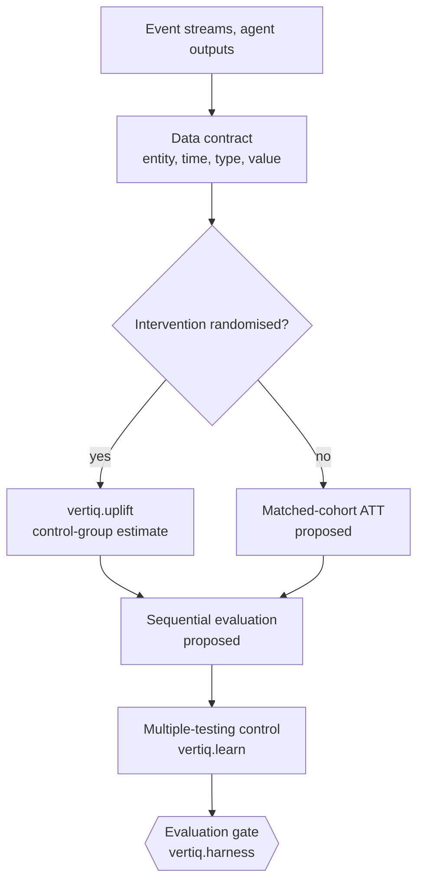

# Proposal 0001: Statistical extensions and public-data validation

| | |
|---|---|
| **Status** | Parts A and B implemented in 0.2 (see below). Part C: the Online Retail II script is written; no public benchmark has been run yet. |
| **Target** | 0.2 |
| **Scope** | Part A: multiple-testing control, matched-cohort effect estimation and sequential evaluation. Part B: survival-based repeat prediction, lagged category sequences and precomputed serving profiles. Part C: validation on public datasets. Pure Python. |
| **Dependencies** | None (Python 3.10+ standard library) |

## Implementation status

| Item | Module | Status |
|---|---|---|
| Benjamini–Yekutieli FDR control | `vertiq.learn.benjamini_yekutieli` | Implemented |
| Matched-cohort ATT | `vertiq.causal.matched_att` | Implemented, with caliper, balance and bootstrap interval |
| Sequential test feeding the gate | `vertiq.sequential`, `harness.evaluate(evidence=...)` | Implemented (one-sample SPRT) |
| Survival-based repeat prediction | `vertiq.survival`, `predict_event(survival=True)` | Implemented |
| Lagged category sequences | `vertiq.sequences.find` | Implemented, with Benjamini–Hochberg filtering |
| Precomputed serving profiles | `vertiq.profiles` | Implemented |
| Public-data validation | `benchmarks/public/online_retail.py` | Script written; not yet run |
| Two-sample sequential test, doubly robust estimation | — | Not started |

# Part A: Statistical validation

## 1. Motivation

Organisations increasingly use language models and automated agents to make or recommend operational decisions: pricing changes,
credit-limit adjustments, outreach, document review. Three statistical problems recur in these deployments:

1. **Multiple testing.** Screening thousands of entities or documents at a fixed significance level produces false positives in
   proportion to the number of true nulls tested. At α = 0.05, testing 10,000 hypotheses that are all null yields about 500 expected
   false positives, and the probability of at least one false positive, 1 − (1 − α)^m, approaches 1.
2. **Attribution without randomisation.** When an intervention was not randomised, comparing treated and untreated entities
   attributes pre-existing differences to the intervention.
3. **Repeated interim analysis.** Checking a fixed-sample test repeatedly as data arrives inflates the type I error rate.

Vertiq already addresses the first problem for insights (`vertiq.learn.benjamini_hochberg`) and the second for randomised
interventions (`vertiq.uplift`, which requires a held-out control group). This proposal adds tools for the cases those modules do not
cover, and connects them to the evaluation gate, which remains the only path to promotion.

## 2. Pipeline



## 3. Methods

### 3.1 False-discovery-rate control (existing; extension proposed)

Given p-values sorted in ascending order $p_{(1)} \le \dots \le p_{(m)}$ and a target rate $q$, the Benjamini–Hochberg procedure finds
the largest $k$ such that

$$p_{(k)} \le \frac{k}{m} q$$

and rejects the hypotheses of rank $1 \dots k$. This bounds the expected proportion of false discoveries at $q$ when the tests are
independent or positively dependent (PRDS).

`vertiq.learn.benjamini_hochberg(pvalues, q=0.1)` implements this today and is used by `vertiq.insights`.

**Proposed addition:** the Benjamini–Yekutieli variant for arbitrary dependence, which replaces $q$ with $q / c(m)$ where
$c(m) = \sum_{i=1}^{m} 1/i$.

```python
from vertiq.learn import benjamini_hochberg

def benjamini_yekutieli(pvalues: list[float], q: float = 0.1) -> list[bool]:
    """FDR control under arbitrary dependence between tests."""
    m = len(pvalues)
    c = sum(1.0 / i for i in range(1, m + 1)) if m else 1.0
    return benjamini_hochberg(pvalues, q / c)
```

**Input requirement.** The procedure is only as valid as its p-values. A p-value must come from a calibrated test (for example
`vertiq.learn.two_proportion_p`, a permutation test, or a model's calibrated null distribution). Scores generated by a language model are
not p-values and must not be passed in as such.

### 3.2 Matched-cohort average treatment effect on the treated (proposed)

When an intervention was not randomised, the average treatment effect on the treated is

$$\tau_{ATT} = E[Y(1) \mid T = 1] - E[Y(0) \mid T = 1]$$

The second term is unobserved. Nearest-neighbour matching estimates it from untreated entities with similar pre-treatment covariates,
using a standardised distance

$$d(i, j) = \sqrt{\sum_{f \in F} \left(\frac{X_{if} - X_{jf}}{\sigma_f}\right)^2}$$

and averages the matched differences.

**Assumptions and safeguards.** The estimate is unbiased only if there are no unobserved confounders (unconfoundedness) and treated
entities have comparable controls (overlap). The implementation therefore:

- matches only within a caliper (default 0.25 standard deviations) and reports unmatched treated entities instead of forcing a match;
- reports covariate balance (standardised mean difference) before and after matching;
- uses only pre-treatment covariates, consistent with Vertiq's point-in-time rule;
- is a fallback. Where a randomised control group exists, `vertiq.uplift` is preferred.

Matching here is nearest-neighbour covariate matching, not the synthetic control method, which builds a weighted combination of
control units for aggregate time series.

```python
import math

def matched_att(records: list[dict], treatment: str, outcome: str, features: list[str], caliper: float = 0.25) -> dict:
    """ATT by 1:1 nearest-neighbour matching with replacement, within a caliper in standard-deviation units."""
    treated = [r for r in records if r[treatment] == 1]
    control = [r for r in records if r[treatment] == 0]
    if not treated or not control:
        return {"status": "insufficient_data", "treated": len(treated), "control": len(control)}
    sd = {}
    for f in features:
        vals = [r[f] for r in records]
        mu = sum(vals) / len(vals)
        sd[f] = math.sqrt(sum((v - mu) ** 2 for v in vals) / len(vals)) or 1.0

    def dist(a, b):
        return math.sqrt(sum(((a[f] - b[f]) / sd[f]) ** 2 for f in features))

    diffs, matched_controls, unmatched = [], [], 0
    for t in treated:
        best = min(control, key=lambda c: dist(t, c))
        if dist(t, best) > caliper * math.sqrt(len(features)):
            unmatched += 1
            continue
        diffs.append(t[outcome] - best[outcome])
        matched_controls.append(best)

    def smd(a, b, f):
        if not a or not b:
            return None
        return (sum(r[f] for r in a) / len(a) - sum(r[f] for r in b) / len(b)) / sd[f]

    matched_treated = [t for t in treated if min(dist(t, c) for c in control) <= caliper * math.sqrt(len(features))]
    return {"status": "ok" if diffs else "no_matches",
            "att": sum(diffs) / len(diffs) if diffs else None,
            "matched": len(diffs), "unmatched": unmatched,
            "balance_before": {f: smd(treated, control, f) for f in features},
            "balance_after": {f: smd(matched_treated, matched_controls, f) for f in features}}
```

Before release this needs a confidence interval (bootstrap over treated units) and an index structure for large control pools; the
sketch above is O(n·m).

### 3.3 Sequential probability ratio test (proposed)

To monitor a binary outcome as it arrives without inflating error rates, Wald's sequential probability ratio test accumulates

$$\Lambda_n = \sum_{i=1}^{n} \left[x_i \ln\frac{\theta_1}{\theta_0} + (1 - x_i) \ln\frac{1 - \theta_1}{1 - \theta_0}\right]$$

where $\theta_0$ is the baseline rate, estimated from history, and $\theta_1 > \theta_0$ is the smallest rate worth adopting. With
type I error $\alpha$ and type II error $\beta$, the approximate boundaries are

$$A = \ln\frac{1 - \beta}{\alpha}, \qquad B = \ln\frac{\beta}{1 - \alpha}$$

Sampling continues while $B < \Lambda_n < A$; crossing $A$ accepts $H_1$ and crossing $B$ accepts $H_0$. Under $H_0$ the likelihood
ratio is a martingale, which is why the error rates hold despite continuous monitoring.

**Scope.** This one-sample form compares a candidate's observed rate with a fixed baseline rate. Comparing two live arms
concurrently requires a two-sample sequential test, such as a mixture SPRT; that is a follow-on item. In either form the test produces
evidence for the evaluation gate. It does not promote or roll back a model by itself.

```python
import math

class SequentialTest:
    """Wald's SPRT for a Bernoulli rate: H0 theta = theta0 against H1 theta = theta1 (theta1 > theta0)."""

    def __init__(self, theta0: float, theta1: float, alpha: float = 0.05, beta: float = 0.2):
        if not (0 < theta0 < theta1 < 1):
            raise ValueError("require 0 < theta0 < theta1 < 1")
        self.win, self.loss = math.log(theta1 / theta0), math.log((1 - theta1) / (1 - theta0))
        self.upper, self.lower = math.log((1 - beta) / alpha), math.log(beta / (1 - alpha))
        self.llr, self.n, self.decision = 0.0, 0, "continue"

    def update(self, outcome: int) -> str:
        """Add one observation (1 = success). Returns 'continue', 'accept_h1' or 'accept_h0'."""
        if self.decision != "continue":
            return self.decision
        self.n += 1
        self.llr += self.win if outcome else self.loss
        if self.llr >= self.upper:
            self.decision = "accept_h1"
        elif self.llr <= self.lower:
            self.decision = "accept_h0"
        return self.decision
```

## 4. Applications by industry

| Industry | Method | Use |
|---|---|---|
| Legal and compliance review | 3.1 | Control the false-discovery rate when screening large document sets with calibrated anomaly tests; reviewers see a list whose expected false share is bounded. |
| Healthcare and life sciences | 3.1 | Apply FDR control to screening results, such as interaction signals, before they advance to further review. |
| Banking and credit | 3.2 | Estimate the effect of non-randomised credit-limit changes on revenue and default against matched accounts, reporting balance and unmatched accounts. |
| Software and subscriptions | 3.2 | Estimate the effect of retention offers that were not randomised; prefer `vertiq.uplift` where a hold-out exists. |
| Retail and dynamic pricing | 3.3 | Monitor a pricing policy's conversion rate against the historical baseline and stop collecting evidence once a boundary is crossed. |
| Industrial assets | 3.3 | Monitor a maintenance policy's failure rate sequentially and pass the result to the evaluation gate. |

## 5. Integration with the evaluation gate

- `harness.evaluate` gains an optional `evidence` argument carrying sequential or matched-cohort results, recorded in the report.
- Promotion still requires the candidate to pass the gate (`min_gain` included). Statistical evidence can block a promotion; it cannot
  bypass the gate.
- All outputs are plain dictionaries, consistent with the rest of the library.

## 6. Tests required before release

- **FDR.** Under simulated nulls the observed false-discovery proportion averages at or below $q$, for BH (independent tests) and BY
  (correlated tests).
- **Matching.** On simulated data with a planted effect and observed confounding, the matched ATT recovers the effect while the naive
  difference does not. Unmatched units are reported when overlap is poor.
- **SPRT.** Over many simulated streams the empirical type I and type II error rates are within the targets, and the average sample size
  is below that of the equivalent fixed-sample test.
- Each method is added to `benchmarks/run.py` as a planted-truth scenario.

## 7. Open questions

- Module layout: a `vertiq/stats.py` module, or a `vertiq/statistics/` package (the first subpackage in the library).
- A two-sample sequential test (mixture SPRT) for concurrent arms.
- Doubly robust estimation, combining a propensity model with an outcome model, as a stronger alternative to matching.

# Part B: Temporal pattern intelligence

## 8. Motivation

Aggregate metrics such as "orders twice a month" hide the signals that matter for repeat purchase: an individual customer slowing
down relative to their own rhythm, a purchase in one category that reliably precedes a purchase in another, and differences in
velocity between stores or channels. Part B extends the decision engine to estimate these patterns directly and to serve them without
recomputing history at request time. The examples use retail; the methods apply to any entity with repeated events.

## 9. What exists today

| Capability | Implementation |
|---|---|
| Individual rhythm | `features.snapshot`: each entity's median inter-event gap, shrunk toward the cohort cadence (`cohort_cadence`) when history is short |
| Overdue against own rhythm | `log_due` feature: recency divided by the entity's expected gap |
| Irregularity and trend | `gap_cv` (coefficient of variation of gaps), `trend` (last 90 days against the previous 90), `spend_trend` |
| Replenishment cycles | `affinity._refills`: per-item median repurchase interval across repeat buyers |
| Co-purchase and next product | `affinity`: lift between items bought together or by the same customers |
| Group effects | per-group offsets in the learned models (`Logistic.fit_offsets`) |
| Scoring cost | the learned models are logistic or linear, so scoring a prepared feature vector is a weighted sum |

These features are inputs to a learned model, and the evaluation gate decides whether the model is used. Part B adds explicit
estimators alongside them.

## 10. Methods

### 10.1 Survival-based repeat prediction (proposed)

Treat the time from one purchase to the next as a duration. Gaps still open at the cutoff are right-censored. The Kaplan–Meier estimator
gives the survival function

$$\hat S(t) = \prod_{t_i \le t} \left(1 - \frac{d_i}{n_i}\right)$$

where $d_i$ purchases occur at time $t_i$ among $n_i$ gaps still at risk. The probability of a purchase within a window $w$, given
none for $e$ days, is

$$P(T \le e + w \mid T > e) = 1 - \frac{\hat S(e + w)}{\hat S(e)}$$

One cohort curve can serve customers with different rhythms by rescaling time by each customer's expected gap relative to the cohort's
(an accelerated-failure-time assumption). The output is a feature and a directly interpretable probability; the evaluation gate decides
whether it improves on the existing model.

```python
def kaplan_meier(durations: list[float], observed: list[bool]) -> list[tuple[float, float]]:
    """Survival curve S(t) of the time to the next purchase. A gap still open at the cutoff is censored
    (observed=False): it counts as 'at risk' until it ends, but not as a purchase."""
    pts, s, at_risk = [(0.0, 1.0)], 1.0, len(durations)
    for t in sorted(set(durations)):
        events = sum(1 for d, o in zip(durations, observed) if d == t and o)
        if events:
            s *= 1 - events / at_risk
            pts.append((t, s))
        at_risk -= sum(1 for d in durations if d == t)
    return pts


def survival_at(curve, t: float) -> float:
    s = 1.0
    for x, v in curve:
        if x > t:
            break
        s = v
    return s


def purchase_within(curve, elapsed: float, window: float, scale: float = 1.0) -> float:
    """P(next purchase within `window` days | none for `elapsed` days) = 1 - S(e + w) / S(e).
    `scale` rescales time by the entity's own rhythm (its expected gap / the cohort's), so one cohort
    curve serves fast and slow buyers."""
    s0 = survival_at(curve, elapsed / scale)
    return 0.0 if s0 == 0 else 1 - survival_at(curve, (elapsed + window) / scale) / s0
```

Verification on simulated exponential gaps with a 12-day mean and 19% independent censoring: $P(\text{within 7 days})$ was 0.457
against a theoretical 0.442, and 0.448 after 12 days without a purchase (theory 0.442, by memorylessness). A customer with a 24-day
rhythm, evaluated through the rescaled curve over 14 days, gave 0.457 against 0.442. Censoring must be independent of the purchase
time; censoring that depends on the outcome biases the estimate.

### 10.2 Lagged category sequences (proposed)

For each pair of consecutive orders by the same customer, count category A followed by category B, and record the lag. Report pairs
whose lift, $P(B \text{ next} \mid A) / P(B \text{ next})$, and support exceed thresholds, with the median lag. Before results are
shown, test each pair's lift with `vertiq.learn.two_proportion_p` and filter the family with Benjamini–Hochberg, as `vertiq.insights`
does for other patterns.

```python
from collections import Counter, defaultdict
from statistics import median

def lagged_transitions(orders: dict[str, list[tuple[int, str]]], min_support: int = 20) -> list[dict]:
    """Category A followed by category B on the customer's next order: support, lift over B's base rate,
    and the median lag in days. orders: {customer: [(day, category), ...]} sorted by day."""
    pair, first, nxt, lags, n = Counter(), Counter(), Counter(), defaultdict(list), 0
    for seq in orders.values():
        for (d1, a), (d2, b) in zip(seq, seq[1:]):
            pair[(a, b)] += 1
            first[a] += 1
            nxt[b] += 1
            lags[(a, b)].append(d2 - d1)
            n += 1
    out = []
    for (a, b), c in pair.items():
        if c < min_support or a == b:
            continue
        lift = (c / first[a]) / (nxt[b] / n)
        out.append({"from": a, "to": b, "support": c, "lift": round(lift, 2), "median_lag_days": median(lags[(a, b)])})
    return sorted(out, key=lambda r: -r["lift"])
```

Verification: with a planted rule (60% of Apparel orders followed by Cosmetics 18 to 22 days later), the first result was
Apparel → Cosmetics with lift 2.0 and a median lag of 20 days.

This is a first-order transition model. Higher-order sequences multiply the number of states and need correspondingly more data; they
are out of scope until first-order results are validated on public data.

### 10.3 Precomputed serving profiles (proposed)

Live requests, such as a checkout or a campaign send, should not recompute history. A scheduled batch job writes:

- **Entity profiles:** the current feature vector from `features.snapshot`, the model score and its contributing factors, and the
  survival-based probability from 10.1, stamped with the time of the latest event included.
- **Group velocity:** units sold per item per store or channel over the reorder window, used by `vertiq.inventory` for reorder points.

A profile is invalidated when a newer event arrives for that entity. Serving then reads one record and, if needed, evaluates the
logistic model as a weighted sum over the stored features. The decision engine remains storage-agnostic: the host application
chooses where profiles are kept.

## 11. Tests required before release

- **Survival:** recovery of known survival curves under independent censoring; calibration of within-window probabilities on held-out
  customers; evaluation through the gate against the current churn model.
- **Sequences:** planted-transition recovery and zero findings on shuffled sequences after Benjamini–Hochberg filtering.
- **Profiles:** scores from a stored profile equal scores computed from raw history at the same cutoff.
- Public-data validation on Online Retail II, which contains real repeat purchases across product categories.

## 12. Corrections to the source notes

The notes this section was drafted from described the existing engine inaccurately in places. For the record:

- Vertiq does not perform tensor decompositions. Its temporal signals are the features listed in section 9.
- The proposed hazard formula in the notes, a fixed decay of the form $0.95 \cdot e^{-0.5 d^2}$, was not estimated from data. Section 10.1
  replaces it with a Kaplan–Meier estimate.
- Predictions are deterministic and reproducible from the same data. That is a property of the method, not a guarantee of
  correctness; accuracy is measured by the evaluation gate on held-out records.
- No latency figures have been measured for serving. The claim that precomputed profiles are faster is expected but must be benchmarked.

# Part C: Validation on public datasets

## 13. Motivation

The current benchmarks use synthetic data with a planted truth. They show that the methods find real signal, reject noise and retain
the baseline when appropriate, but they do not show performance on real operational data. Part C defines a validation programme on
public datasets, one per core use case, with fixed protocols so results can be reproduced.

## 14. Datasets

| Use case | Dataset | Source and terms | What it contains |
|---|---|---|---|
| Repeat purchase, affinity, table mapping | Online Retail II | UCI Machine Learning Repository, CC BY 4.0 | About 1.07 million invoice lines from a UK online retailer, December 2009 to December 2011: `Invoice`, `StockCode`, `Description`, `Quantity`, `InvoiceDate`, `Price`, `Customer ID`, `Country` |
| Value prediction and inventory velocity | M5 Forecasting | Kaggle competition data; access requires accepting the competition rules; not redistributable | Daily unit sales for 3,049 products across 10 Walmart stores in 3 US states, with prices, promotions and calendar events |
| Equipment failure | C-MAPSS | NASA Prognostics Center of Excellence | Simulated run-to-failure trajectories for turbofan engines: 21 sensor channels and 3 operating settings per cycle, in four subsets (FD001 to FD004) |
| Subscription churn | KKBOX churn prediction | Kaggle (WSDM Cup 2018); access requires accepting the competition rules; not redistributable | Subscription transactions with plan, payment, auto-renew and cancellation fields, plus user logs |
| Uplift from randomised treatment | Hillstrom email test | MineThatData, public | 64,000 customers randomly assigned to a men's email, a women's email or no email, with visit, conversion and spend outcomes |
| Uplift at scale | Criteo Uplift | Criteo AI Lab, CC BY-NC-SA 4.0 | About 13 million rows from randomised incrementality tests, with treatment, visit and conversion labels |

Data files are never committed. Benchmark scripts read files the user has downloaded and accepted the terms for, from a path given on
the command line.

## 15. Protocols

### 15.1 Online Retail II: repeat purchase

1. Remove cancellations (invoices beginning with `C`) and lines without a customer.
2. Aggregate lines to orders: one event per invoice, with value `Quantity × Price` summed across lines, and stock codes kept as items.
3. Map `Customer ID` to the entity, the invoice timestamp to time and `Country` to the group. Run Vertiq LM on the raw header and
   sample rows first, and record whether its mapping, after `vertiq.mapping.repair`, matches this reference mapping.
4. Run `predict_event(target="", window_days=60)` and `predict_value(...)` with the standard cutoffs and entity-level holdout.
5. Report AUC, Brier score and calibration against the recency baseline, and, as an external reference, against a logistic
   regression and a gradient-boosted model from scikit-learn and LightGBM on the same features. External libraries are used only in
   the benchmark script, never in the package.
6. Run `affinity` and the lagged sequence finder (Part B) on the same orders and report the top patterns with their support.

### 15.2 M5: value prediction and velocity

Treat each item and store pair as an entity with daily sales events. Evaluate `predict_value` on next-period units against the
same-as-last-period baseline, and compare reorder points from `vertiq.inventory` with realised demand. Vertiq is not a forecasting
system; this protocol measures whether its value prediction and velocity estimates are useful, not whether it competes with
dedicated forecasting models on the competition metric.

### 15.3 C-MAPSS: equipment failure

C-MAPSS records cycles, not dates. Map each engine to an entity and convert cycle indices to synthetic dates one day apart. Define
the failure event at each engine's final cycle and predict failure within a horizon of N cycles. Sensor channels enter through
feature plugins that compute rolling levels and slopes, since degradation appears as trends rather than isolated spikes. Report AUC
against a cycle-count baseline. Once the sequential test from Part A is implemented, apply it to the stream of per-cycle alerts.

### 15.4 KKBOX: subscription churn

Map each user to an entity and each transaction to an event, with cancellation as the target event type. Evaluate
`predict_event(target="cancel", ...)` against the recency baseline. This dataset has no randomised treatment, so it is not used for
uplift; any treatment effect estimated from it would be confounded by who chose auto-renewal or promotions.

### 15.5 Hillstrom and Criteo: uplift

Both datasets come from randomised experiments, so the true average effect is known from the treatment and control means. Evaluate
`vertiq.uplift` by Qini and uplift curves on held-out customers, and check that the estimated average effect falls within the
experiment's confidence interval. Use the matched-cohort estimator from Part A on Hillstrom with the randomisation ignored, as a
check that it approaches the experimental estimate.

## 16. Indicators

Every run reports the following, in addition to accuracy:

| Indicator | Measure |
|---|---|
| Mapping accuracy | Whether Vertiq LM's mapping, after validation, matches the reference mapping; rows that fail to load and why |
| Processing time | Wall-clock time for each stage at 1,000, 10,000, 100,000 and 1,000,000 rows, on stated hardware |
| Memory | Peak resident memory for the same sizes |
| Gate behaviour under corruption | With a share of rows replaced by noise or with labels shuffled, whether the gate retains the baseline, and at what corruption level |
| Calibration | Reliability of predicted probabilities on held-out entities |

## 17. Deliverables

- `benchmarks/public/` with one script per dataset, reading from a user-supplied path.
- `benchmarks/results/public.json` with results, dataset versions and hardware, generated by the scripts.
- A results section in the README and on the benchmarks page, generated from that file as the synthetic results are today.
- Online Retail II first, as it exercises mapping, repeat purchase and affinity together and its licence permits redistribution of
  results.

## References

- Benjamini, Y. and Hochberg, Y. (1995). Controlling the false discovery rate. *Journal of the Royal Statistical Society B*, 57(1).
- Benjamini, Y. and Yekutieli, D. (2001). The control of the false discovery rate in multiple testing under dependency. *Annals of Statistics*, 29(4).
- Rubin, D. B. (1974). Estimating causal effects of treatments in randomized and nonrandomized studies. *Journal of Educational Psychology*, 66(5).
- Stuart, E. A. (2010). Matching methods for causal inference: a review and a look forward. *Statistical Science*, 25(1).
- Wald, A. (1945). Sequential tests of statistical hypotheses. *Annals of Mathematical Statistics*, 16(2).
- Chen, D., Sain, S. L. and Guo, K. (2012). Data mining for the online retail industry. *Journal of Database Marketing and Customer Strategy Management*, 19(3).
- Hillstrom, K. (2008). The MineThatData E-Mail Analytics and Data Mining Challenge. MineThatData.
- Diemert, E., Betlei, A., Renaudin, C. and Amini, M.-R. (2018). A large scale benchmark for uplift modeling. AdKDD.
- Saxena, A., Goebel, K., Simon, D. and Eklund, N. (2008). Damage propagation modeling for aircraft engine run-to-failure simulation. PHM 2008.
- Kaplan, E. L. and Meier, P. (1958). Nonparametric estimation from incomplete observations. *Journal of the American Statistical Association*, 53(282).
- Johari, R., Pekelis, L. and Walsh, D. (2017). Always valid inference: bringing sequential analysis to A/B testing. arXiv:1512.04922.
